<div align="center">

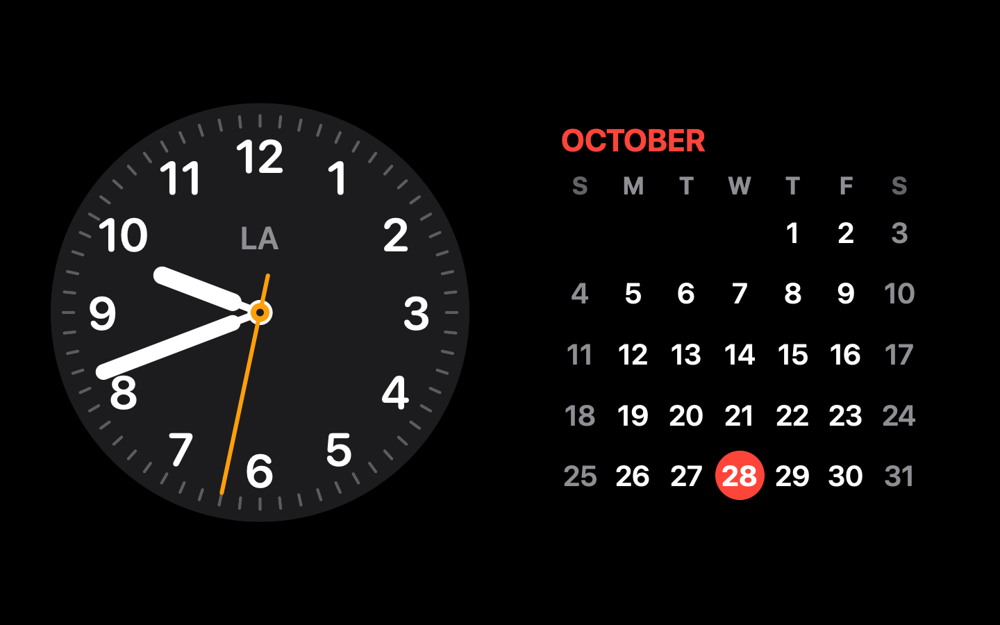

# Standby

**iPhone-style StandBy for your Mac.**

When you're not using your MacBook's screen, Standby turns it into a beautiful bedside-style display:<br>widgets, a big clock, or your photos, while you keep working on your other monitor.

[**Download**](https://github.com/vivaanseth/standby-mac/releases/latest) · [Features](#features) · [Install](#install) · [How to use it](#how-to-use-it) · [Settings](#settings) · [FAQ](#faq)


</div>

---

## Features

### 🖥️ It knows which screen you're using
- **Working on an external monitor?** Only your MacBook's screen goes into Standby. You keep working, uninterrupted.
- **Stepped away from everything?** Your external monitor gets its own Standby too.
- **Just a MacBook?** It works like a screen saver.

No special permissions needed. It watches where your pointer and typing are, not what you're doing.

### 🧩 17 widgets, stacked like on iPhone

Swipe up and down through Smart Stacks, and arrange up to six of them in five layouts.

<p align="center">
  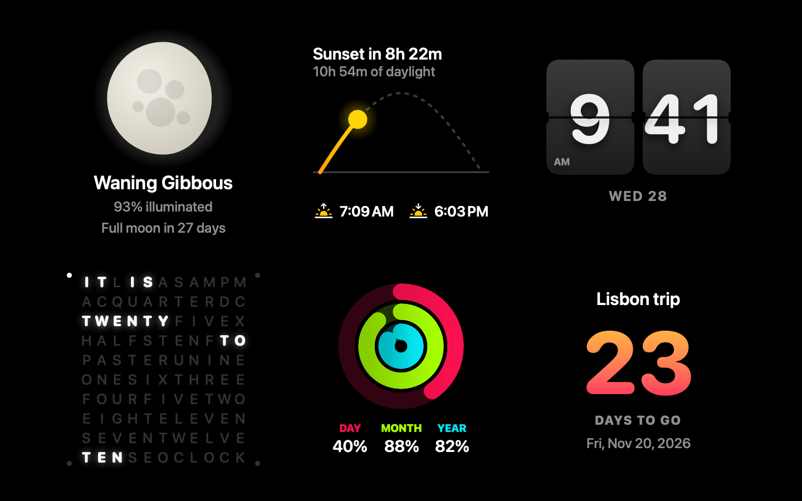
  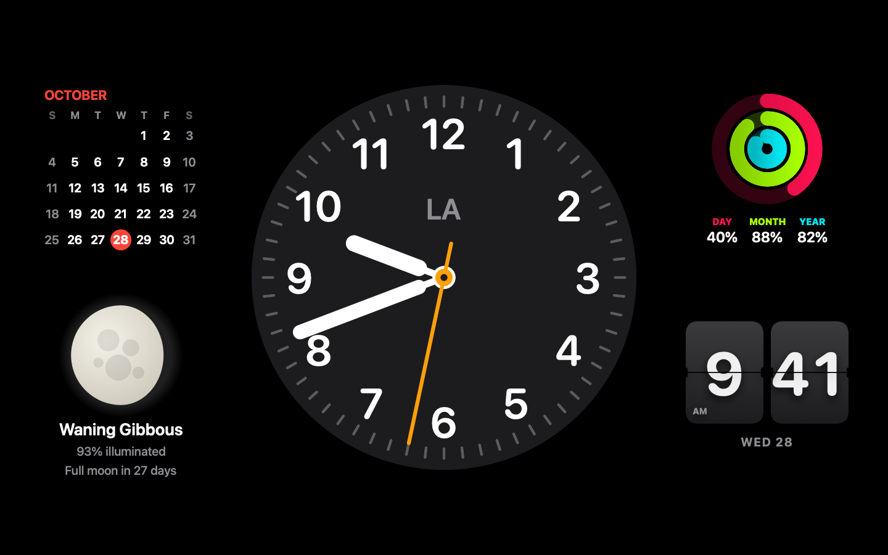
</p>

Clock · Calendar · Up Next · Date · Digital Clock · World Clock · Weather · Batteries · Photos · Moon · Sunrise & Sunset · Flip Clock · Word Clock · Time Rings · Countdown · Note · Mac Activity

### ⏰ Five clock faces

<p align="center">
  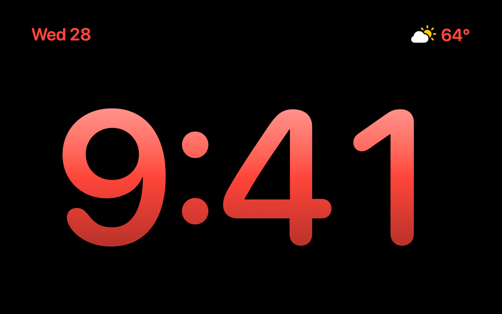
  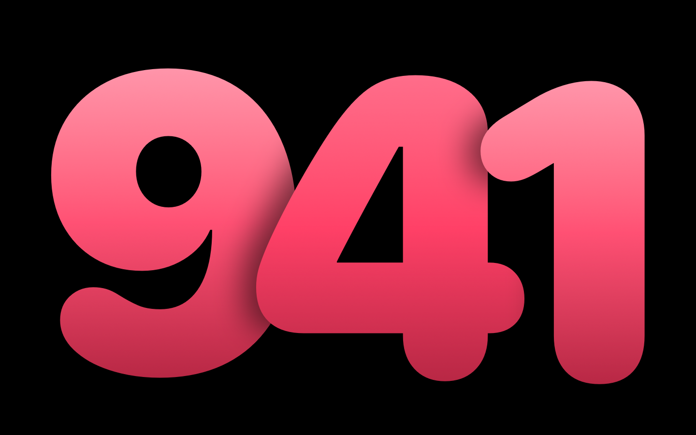
  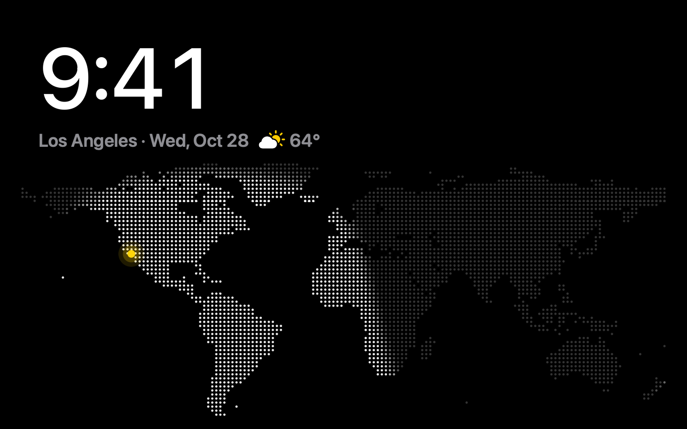
</p>
<p align="center">
  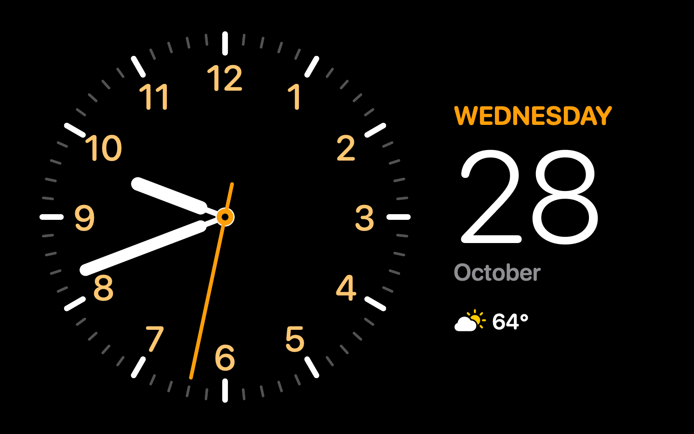
  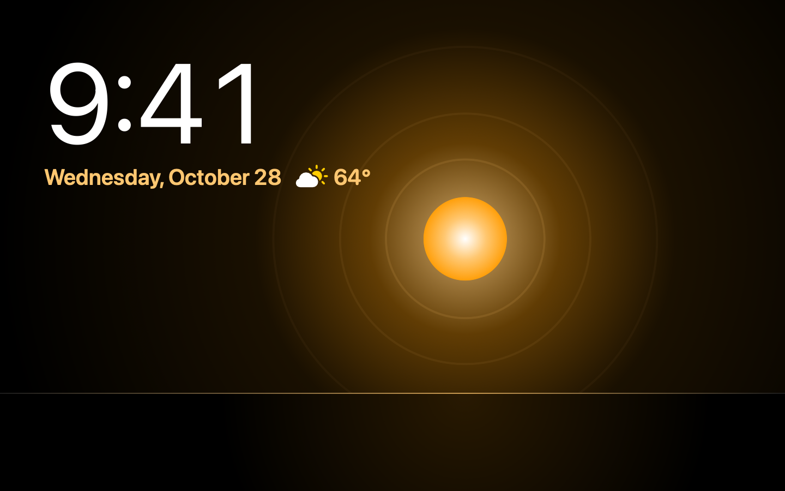
  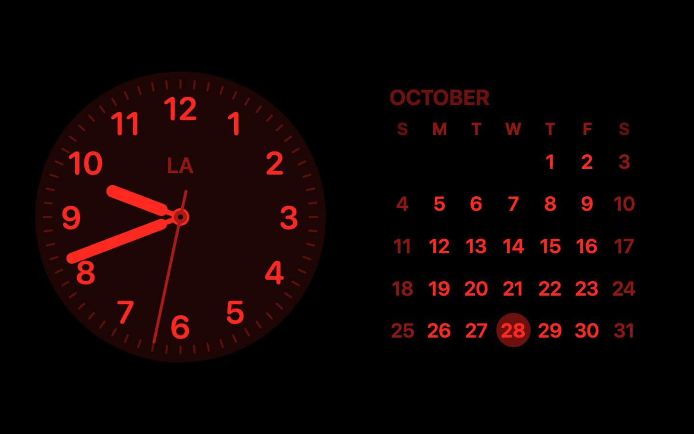
</p>

**Digital**, **Analog**, **World**, **Solar** and **Float**, each in your choice of color. The World and Solar faces follow the real sun. **Night Mode** turns everything a dim red for dark rooms.

### 🖼️ Photos
A slideshow from any folder, with a gentle zoom and the time in the corner.

<p align="center">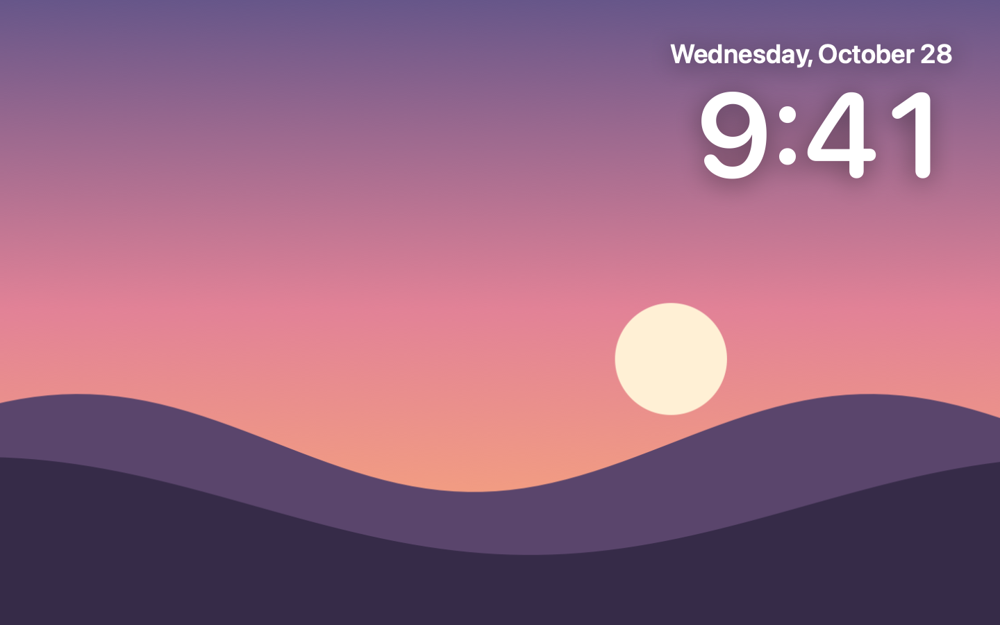</p>

### 🌄 Your external monitor, too
When nothing is in use, your external display shows its own Standby: by default the clock, to complement the widgets on your MacBook. Or choose **Sky**, a live window onto the sky where you are.

<p align="center">
  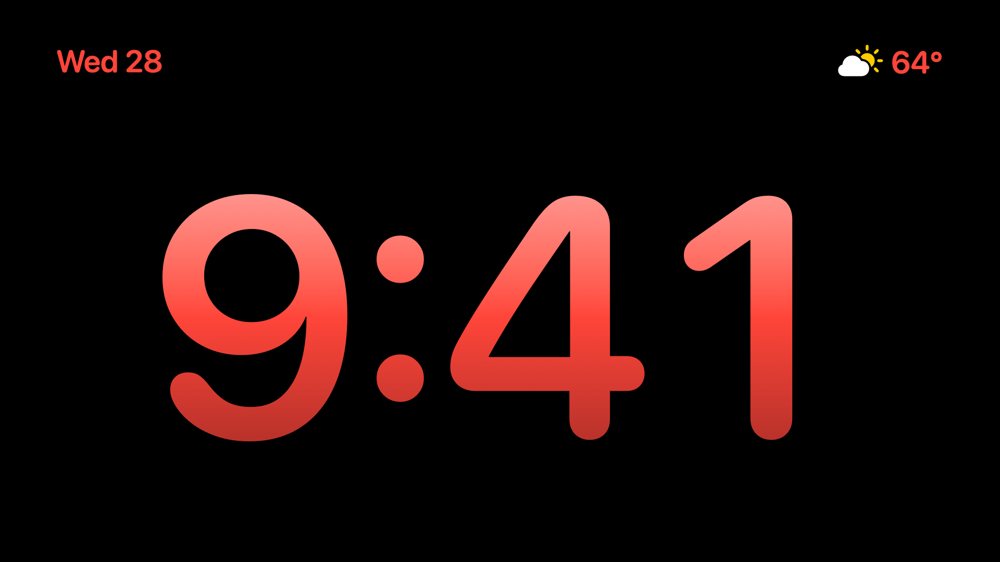
  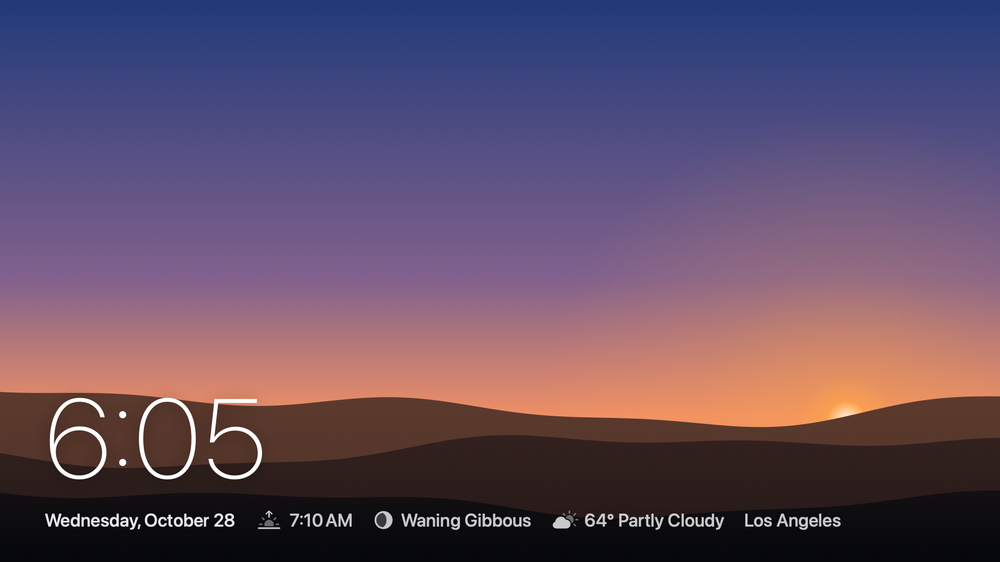
</p>

---

## Install

1. Download the **.dmg** from the [latest release](https://github.com/vivaanseth/standby-mac/releases/latest).
2. Open it and drag **Standby** onto the **Applications** folder.
3. The first time, **right-click Standby → Open**, then click **Open**. (Standby isn't notarized by Apple, so macOS asks once.)
4. Settings opens automatically. Look for the clock icon in your menu bar.

> **Requirements:** macOS 14 Sonoma or later, on any Apple silicon or Intel Mac.

---

## How to use it

Just leave it running. Standby starts on its own after your screen has been unused for a couple of minutes.

| To… | Do this |
|---|---|
| Show or hide Standby now | Press **⌃⌥⌘S**, or use the menu bar icon |
| Switch between Widgets, Photos and Clock | Swipe left or right with two fingers, or press **← →** |
| Flip through a widget stack or clock faces | Swipe up or down on it, or press **↑ ↓** |
| Wake up | Click, press any key, or move the pointer |
| Pause for a while | Menu bar icon → **Pause** |

---

## Settings

Open **Settings** from the menu bar icon (or press **⌘,**). Every change shows up in a live preview.

| Tab | What you can change |
|---|---|
| **General** | When Standby starts, what wakes it, open at login, keyboard shortcut |
| **Views** | Which views appear, 12/24-hour time, °C/°F, weather city |
| **External** | What your external display shows, and when |
| **Widgets** | Number of stacks, layout, which widgets, Smart Rotate, countdown, note |
| **Clock** | Which faces, their order, and their colors |
| **Photos** | Photo folder, how often photos change, where the time sits |
| **Display** | Brightness, Night Mode schedule, burn-in protection |

---

## FAQ

<details>
<summary><b>Does Standby need any permissions?</b></summary>

No. Calendar access is requested only if you add the Up Next widget.
</details>

<details>
<summary><b>Does it send any of my data anywhere?</b></summary>

No. The only network request is for weather, from <a href="https://open-meteo.com">Open-Meteo</a>, and only after you pick a city. Just that city's coordinates are sent.
</details>

<details>
<summary><b>Standby doesn't appear, or the screen turns off first.</b></summary>

macOS may be turning off the display or starting its own screen saver first. Give it more time in <b>System Settings → Lock Screen</b>, or turn on <b>Keep the display awake while Standby is showing</b> in Standby's settings. Standby also waits while a video or call is keeping the screen on.
</details>

<details>
<summary><b>Why didn't Standby start?</b></summary>

An app may be keeping your Mac awake, such as Caffeinate, Amphetamine, an AI agent at work, or a video or call. Playing music doesn't count. The menu bar icon shows the app's name, and you can turn this off in <b>Settings → General</b>.
</details>

<details>
<summary><b>Does Standby get in the way of AI agents that use the screen?</b></summary>

No. Standby is left out of screenshots, so an agent sees what's really on the screen. When something captures the screen or sends automated mouse input, Standby leaves every display and stays away for 2 minutes after the last activity. Your own screenshots and screen sharing count too. You can turn this off in <b>Settings → General</b>. Scripts can ask for the same thing with <code>--yield</code>.
</details>

<details>
<summary><b>I hid the menu bar icon. How do I get back to Settings?</b></summary>

Open Standby again from Applications or Spotlight.
</details>

<details>
<summary><b>Can I control it from Shortcuts or the Terminal?</b></summary>

Yes: <code>/Applications/Standby.app/Contents/MacOS/Standby --show</code> (or <code>--hide</code>, <code>--toggle</code>, <code>--yield</code>).
</details>

---

## Build from source

Requires macOS 14+ and Xcode or the Command Line Tools.

```bash
git clone https://github.com/vivaanseth/standby-mac.git
cd standby-mac
./build.sh install
```

`./build.sh` alone builds `build/Standby.app` without installing it. `Standby --render <folder>` saves a picture of every screen.

---

## Credits

World map from [Natural Earth](https://www.naturalearthdata.com) (public domain) · Weather by [Open-Meteo](https://open-meteo.com)

Standby is an independent project inspired by StandBy on iPhone. It isn't affiliated with or endorsed by Apple.

## License

© 2026 Vivaan Seth. Licensed under the [PolyForm Noncommercial License 1.0.0](LICENSE).

- ✅ Download and use Standby for yourself
- ✅ Study the code, change it, and build on it
- ✅ Share it and your changes, for free, with this license included
- ❌ Sell it, or use it for any commercial purpose

Want to use it commercially? Open an issue to ask.
